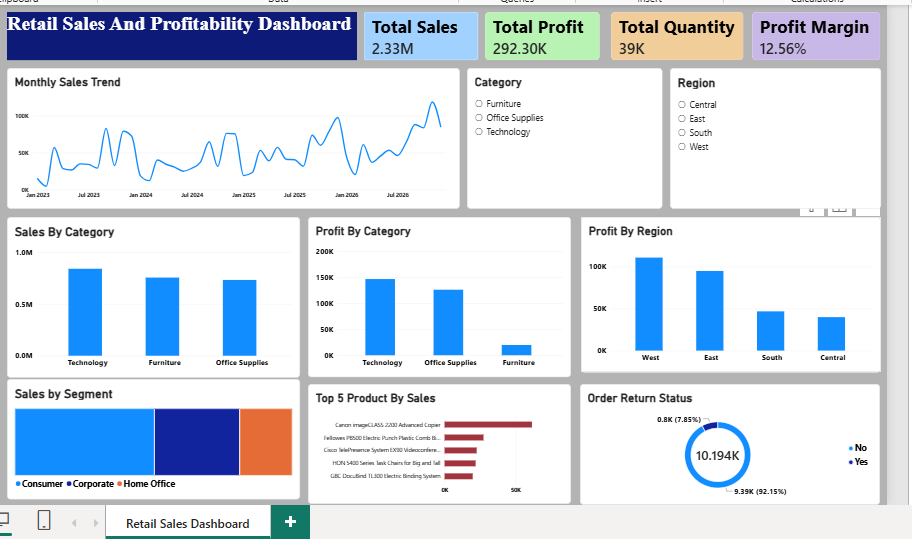

Retail Sales Analysis Project

## Project Overview

This project analyzes retail sales data to understand sales performance, profitability, product trends, regional performance, and product returns. It demonstrates practical skills in data preparation, exploratory data analysis, SQL querying, and interactive dashboard development.

## Tools & Technologies

- **Microsoft Excel:** Data cleaning, preparation, and analysis.
- **Power BI:** Interactive dashboards, data visualizations, and business insights.
- **SQL Server:** Data querying, aggregations, joins, subqueries, Common Table Expressions (CTEs), and window functions.

## Project Structure

```text
Retail_Sales_Analysis_Project/
├── 01_Excel/
│   └── Source datasets and prepared Excel files
├── 02_PowerBI/
│   └── Power BI dashboard file (.pbix)
├── 03_SQL/
│   ├── 01_Database_Setup.sql
│   ├── 02_Retail_Sales_Analysis.sql
│   └── 03_People_Table_Cleanup.sql
└── README.md
```

**Dashboard Preview**

  

## Analysis Performed

- Overall sales, profit, and quantity analysis
- Regional and category-wise performance analysis
- Monthly sales and profit trends
- Identification of top-selling and loss-making products
- Discount-wise sales and profitability analysis
- Order return analysis and regional manager lookups
- Profit classification using conditional logic
- Advanced analysis using subqueries, CTEs, and ranking functions

## Key Objectives

- Identify sales and profitability trends.
- Compare performance across regions and product categories.
- Highlight products generating losses.
- Explore the relationship between discounts and profitability.
- Present findings through an interactive Power BI dashboard.

## How to Explore This Project

1. Review the source datasets and prepared Excel files in `01_Excel/`.
2. Open the `.pbix` file in Power BI Desktop to explore the interactive dashboard.
3. Open the SQL scripts in SQL Server Management Studio (SSMS) to review the database setup and analysis queries.

## Important Note

The SQL scripts are designed for Microsoft SQL Server. Review the database setup and cleanup scripts before executing them. The People table cleanup script contains a `DELETE` statement and should only be executed after verifying the targeted records.

## Author

**Nayna Jha**

Aspiring Data Analyst | Microsoft Excel | Power BI | SQL

